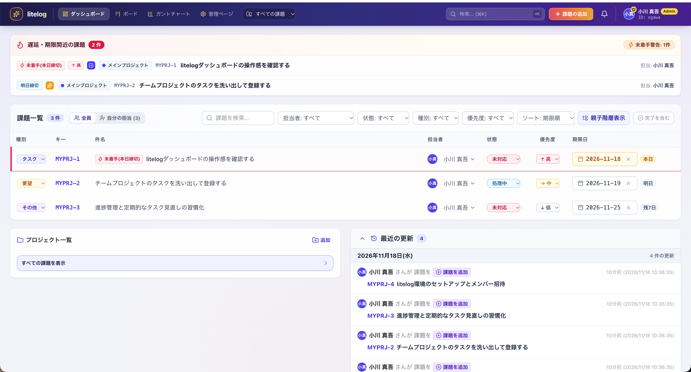
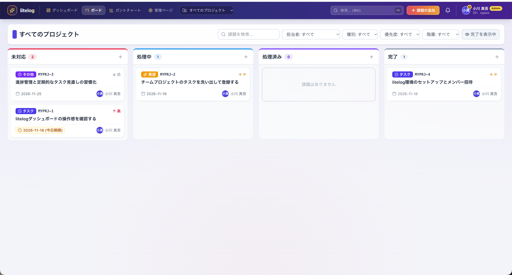
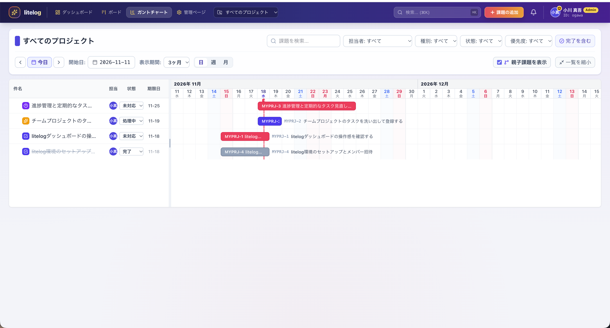

# litelog

個人や小さなチームで気楽に使える、Backlogライクなタスク・課題管理ツールです。  
外部DB不要（Node.js組み込みのSQLite）なので、Dockerやローカルですぐ動きます。



---

## 📸 画面プレビュー

| かんばんボード（Board） | ガントチャート（Gantt） |
| :---: | :---: |
| [](docs/images/board.png) | [](docs/images/gantt.png) |

---

## 🌟 主な機能

- **📋 柔軟な課題管理**
  - **一覧テーブル**: ステータス・担当者・期限・種別・優先度・完了理由のインプレース編集
  - **かんばんボード**: ドラッグ＆ドロップによる直感的なステータス変更
  - **ガントチャート**: バーの伸縮・移動操作、親子課題ツリー、日本の祝日表示
  - **横断検索**: プロジェクトをまたいだキーワード検索＆進捗マトリクス表示
- **👥 チーム運用 & アカウント管理**
  - **認証 & ロール**: 権限分離（Admin / PMO / メンバー）、2要素認証（Google Authenticator等対応）
  - **通知機能**: 担当アサイン、更新・コメント通知、`@`メンション、ヘッダー通知ベル
- **💬 コミュニケーション & リッチ編集**
  - **Markdown対応**: ツールバー付きエディタ、プレビュー切り替え
  - **ファイル添付**: クリップボードからのスクショ貼り付け（`Cmd/Ctrl + V`）、ドラッグ＆ドロップ対応
  - **履歴・ログ**: 課題変更履歴（期日・詳細など）やコメント編集履歴の保持
- **⚙️ カスタマイズ & 運用**
  - **外観テーマ**: ダークモードを含む6つのカラーテーマ
  - **カレンダー・日時**: 週開始曜日（月/日）、タイムゾーン（JST等）、日本の祝日表示
  - **データ管理**: JSON形式でのワンクリック バックアップ＆復元
- **📱 スマートフォン対応**
  - レスポンシブ対応。iPhone等のスマホブラウザからでも課題の確認・登録、ステータス変更が手軽に行えます

> 💡 画面ごとの詳しい操作手順やFAQは **[MANUAL.md](MANUAL.md)** をご覧ください。

---

## 🚀 クイックスタート

### 必要要件
- **Node.js**: `v22.5.0` 以上（組み込みの `node:sqlite` を使用）
- **ブラウザ**: Chrome, Edge, Safari, Firefox など

### 1. ローカル起動
```bash
# 依存関係のインストール
npm install

# 開発サーバーの起動
npm run dev
```
ブラウザで [http://localhost:3000](http://localhost:3000) を開きます。  
※ 初回アクセス時に管理者アカウント作成画面が表示されます。

### 2. 本番ビルド
```bash
npm run build
npm start
```

### 3. Docker / Docker Compose
```bash
# コンテナのビルド & 起動
docker compose up -d --build

# 停止
docker compose down
```
※ データはホスト側の `./data/litelog.db` に永続化されます。

### 4. テスト実行
```bash
npm test
```

---

## 🛠 技術スタック

- **フロントエンド / バックエンド**: Next.js (App Router, React 19), TypeScript
- **データベース**: SQLite（Node.js 組み込み `node:sqlite`）
- **スタイリング**: Tailwind CSS
- **アイコン**: Lucide React
- **認証**: パスワード暗号化（scrypt）、セッション管理（HMAC）、2要素認証（TOTP / Authenticator対応）

---

## 📖 ドキュメント

- [MANUAL.md](MANUAL.md) - 詳細な操作マニュアル・仕様解説
- [deploy/README.md](deploy/README.md) - Proxmox LXC などのサーバー自動起動セットアップガイド
